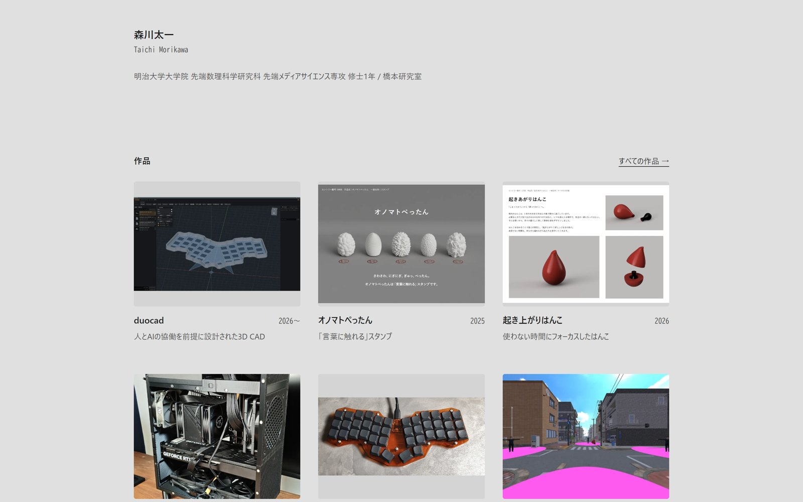

# portfolio

森川太一の作品ポートフォリオサイトのソースコードです。

**公開中のサイト: https://portfolio.m-kw.net**



## 特徴

- フレームワークは [Astro](https://astro.build/)（静的出力）だけ。スタイルは素の CSS
- 作品1件が1フォルダ（`src/content/works/<slug>/`）。Markdown と画像を置けば一覧と作品ページができる
- 経歴は `src/data/profile.ts`、トップに出す作品と順番は `src/data/featured.ts` にまとめている
- Cloudflare Workers の静的アセットとして配信

## 動かす

Node.js が必要です。

```bash
npm install
npm run dev      # http://localhost:4321
npm run build    # dist/ に静的ファイルを出力
```

## 構成

```
src/
  content/works/<slug>/   作品ごとの index.md と画像
  data/profile.ts         経歴
  data/featured.ts        トップに出す作品
public/media/             動画など
scripts/                  動画の圧縮などの補助スクリプト
docs/                     構成・見た目の判断の記録
```

## 作品を足す

`src/content/works/<slug>/index.md` を作ります（slug は半角英小文字とハイフン）。

```markdown
---
title: "作品名"
year: 2026
summary: "一覧カードに出す1行"
context: "個人制作"
role: ""
tools: ["Python"]
cover: ./cover.jpg
coverFit: cover
---

本文。画像は 
```

細かい書式と編集の手順は [docs/DEVELOPMENT.md](docs/DEVELOPMENT.md) にあります。

## 公開する

```bash
npx wrangler login   # 初回だけ
npm run deploy       # ビルドして Cloudflare Workers に上げる
```

## ライセンス

[MIT](LICENSE)
