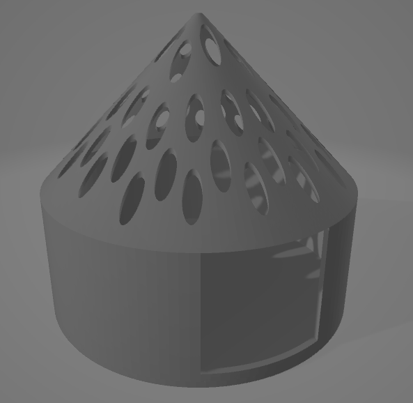

3つのLEDキャンドルを吊るしたモビール。キャンドルが揺れると、LEDの光もそれに合わせて揺らぐ。各キャンドルの底面に再帰性反射材が貼られており、それを赤外線カメラで撮影することで同一のキャンドルを追跡し続けている。

<video src="/media/candle-mobile/candle_mobile_002.mp4" controls preload="metadata" playsinline></video>

基盤とバッテリーを隠蔽するためのキャンドルカバーは3Dプリンタで印刷。四角い開口部以外はサポートなしで印刷可能。

