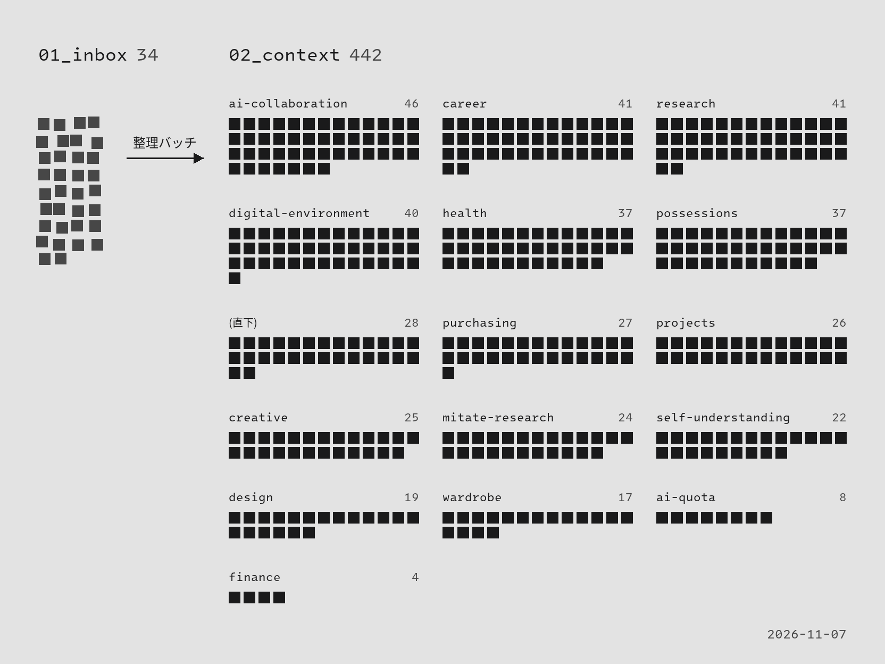

AIを動かす仕組みは、自作しても数か月で標準機能に置き換わっていく。一方で、私が何を考え、何を決めてきたかという文脈は、AIが替わっても使い続けられる。context-engine は、この私についての文脈だけを、どのAIからも読める形で手元に持つための置き場である。

そのため、特定のAIの機能には頼らず、Markdown のファイルとフォルダだけで作った。AIは入口の index.md を読み、いまの作業に要るノートだけを選んで読む。置くのは時間が経っても真であり続ける情報だけで、作業の途中経過は置かない。

ノートは私ではなくAIが書き、整理する。会話の中に私の価値観や判断が出てくると、AIがその場でメモにし、あとで分類してフォルダに収める。フォルダもあらかじめ決めず、ノートが増えて置き場所に迷うようになったら足していく。

ただし、書いてよいのは私が言ったことと決めたことだけにしている。AIが調べたことや推測したことが混ざると、AIが私の判断を予測するときの材料が、AI自身の推論で汚れてしまうからだ。

中身は個人情報なので公開していない。
