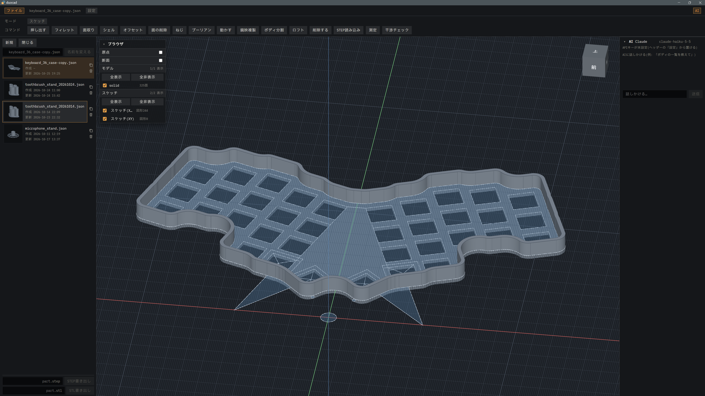

3D モデリングに AI を組み込む流れは加速しているが、既存の 3D CAD の多くは、反復作業も含めてすべてをユーザーが操作するか、すべてを AI に任せるかのどちらかに偏っている。しかしモデリングでまず AI に任せるべきなのは、何十本もある辺をひとつずつクリックして選ぶような単調な操作である。

duocad では、「辺をひとつ選ぶ」といった細かい粒度の操作まで、ユーザーと AI が同じように行える。AI に選択だけを任せれば、その結果はユーザーが自分で選んだときと同じ形で画面に残るので、確かめて直してから次の操作に進める。たとえば次のように、互いの得意な部分を生かして交互に操作できる。

1. AI に「上向きの面を構成する辺をすべて選択して」と指示する。
2. AI が選んだ辺を画面で確かめ、過不足があれば手で直す。
3. 選んだ辺にフィレットをかける。

ソースコード: [duocad](https://github.com/morikawa976321/duocad)
