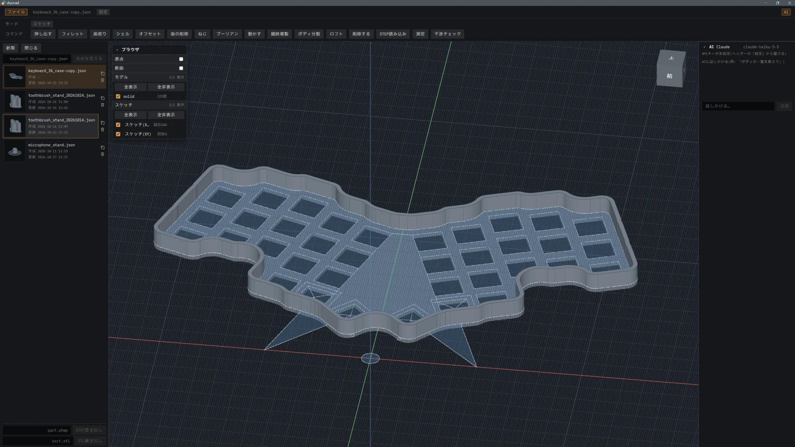

3DモデリングにAIを統合する流れは加速しているが、既存の多くの3DCADは、反復作業まですべてユーザーがやるか、すべてをAIに任せるかのいずれかに偏っている。モデリング作業で優先してAIに投げるべきは「何十本もある辺をクリックしてひとつずつ選択する」といった操作のはずである。duocadでは、「辺を一つ選択する」といった細かい粒度の操作まで、すべての操作をユーザーもAIも行える。これによりユーザーは、
1. AIに「上向きの面を構成する辺をすべて選択して」という指示を行う。
2. AIの選択を見て過不足があれば手動で修正する。
3. 操作を実行する。

といった互いの得意な部分を生かした交互操作が可能になる。

