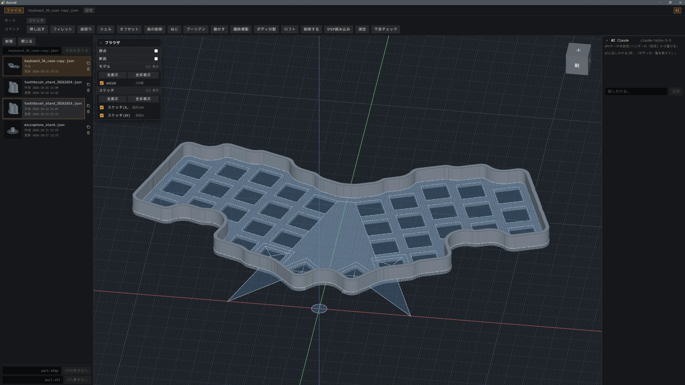

<figure class="slot wide"><b>01-select.png</b>面がいくつか選ばれて色が付いている作業中の画面。AI のパネルに依頼の文が見えるとよい</figure>

<figure class="slot"><b>02-models.jpg</b>duocad で作ったモデル(歯ブラシ立て・マイクスタンド・キーボードのケース)の実物か画面</figure>

<figure class="slot wide"><b>03-topopt.png</b>形状最適化の結果(材料を削って骨組みになった形)</figure>
