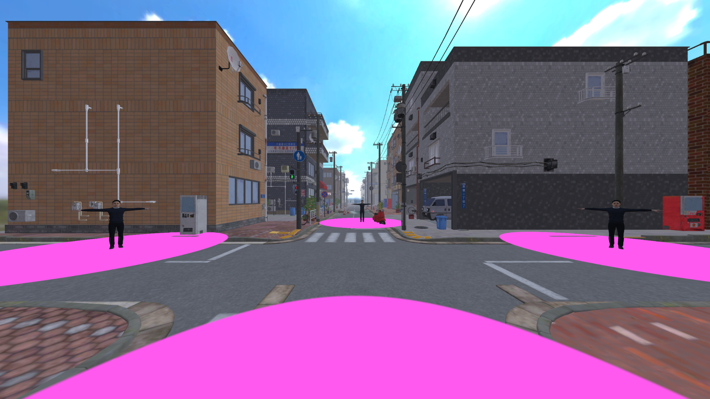
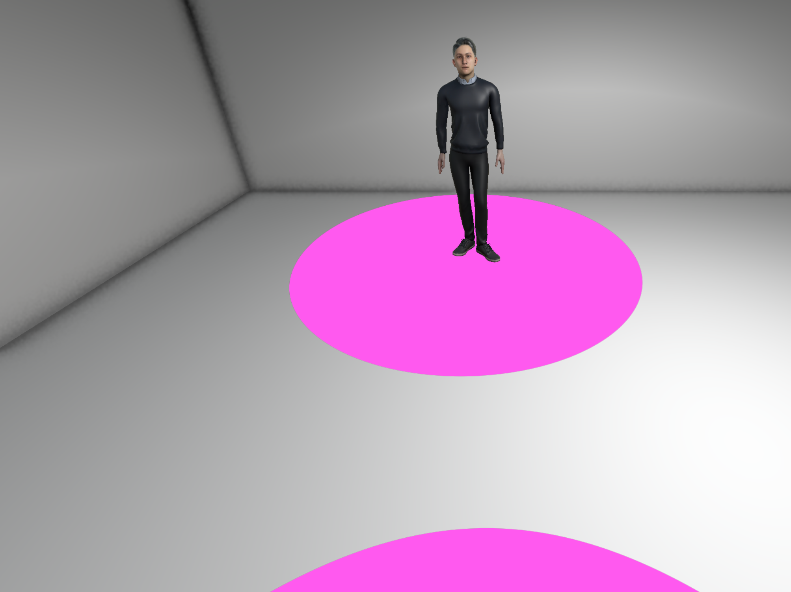
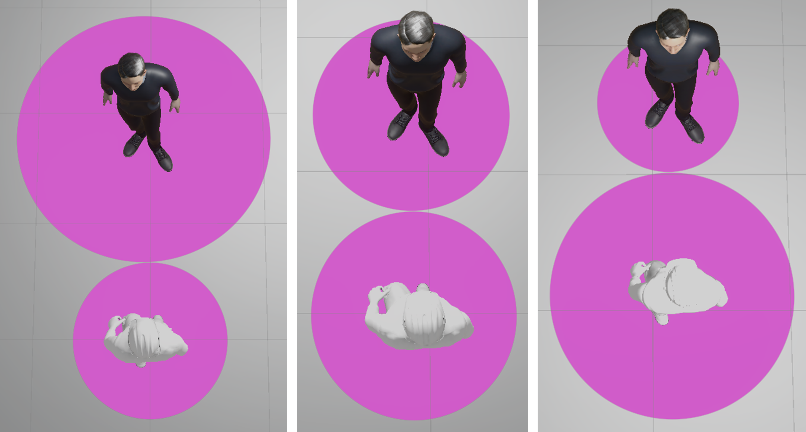
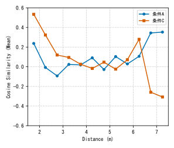

人と人のあいだのどのくらいの距離を心地よく感じるかは、部屋の広さや混み具合といった周りの環境で変わる。これを利用して、足元の床に領域を描くなどの見せ方で対人距離を操作する研究がある。ただし、どれも近づかれる側が立ち止まった状態で確かめたものだった。実際の対人距離は、お互いが動きながら絶えず調整し合うものである。この研究では、自分も相手も自由に動き回れるVR空間で、床に描いた円の大きさの変化が対人距離にどう影響するかを調べた。

予備実験では、参加者と3体のアバタの足元にピンクの円を描いた。近づくと2つの円は重ならず、円周で接したまま縮む。縮み方はアバタごとに変えてあり、相手の円のほうが速く縮むこともあれば、自分の円のほうが速く縮むこともある。大学生10人に自由に近づいたり離れたりしてもらって感想を聞くと、「相手の円が自分より小さくなると受け入れられている、大きくなると拒まれていると感じた」という声が出た。円は、相手が踏み込まれたくない範囲として受け取られていた。

本実験では、Unityで3つの部屋を通路でつないだVR空間を作り、実験者の操作するアバタと参加者が一緒に部屋を進むようにした。円の半径はふだん1.5mで、2人の距離が3m未満になると縮む。部屋ごとに縮み方を変え、相手の円が速く縮む条件A、同じ大きさのまま縮む条件B、自分の円が速く縮む条件Cとした。参加者は大学生12人で、部屋によって円の縮み方が違うことは伝えていない。

2体のアバタの距離と移動の向きを毎フレーム記録し、条件Aと条件Cを比べた。条件Aでは、3m未満の近い距離にいた時間が条件Cより長かった(全体に占める割合で19.6%と13.8%。有意差は出なかった)。また、3m未満で2人の移動の向きがどれだけそろっていたか(コサイン類似度)を見ると、条件Cでは大きく上がり、条件Aではほとんど変わらなかった(t(11) = -2.71, p = .020)。条件Cでは相手と同じ向きに動いて距離を保とうとしていたのに対し、条件Aでは相手が近いことをあまり気にしていなかったことになる。

記録したのは距離と向きだけなので、この差がなぜ生まれたかまでは分からない。予備実験の感想どおり相手に受け入れられていると感じたためなのか、円の見え方のせいで近づいたことに気づきにくかっただけなのかを確かめるには、参加者の受け止め方を尋ねる実験が要る。
