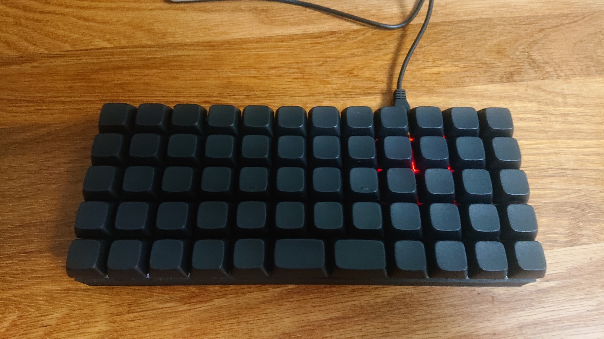
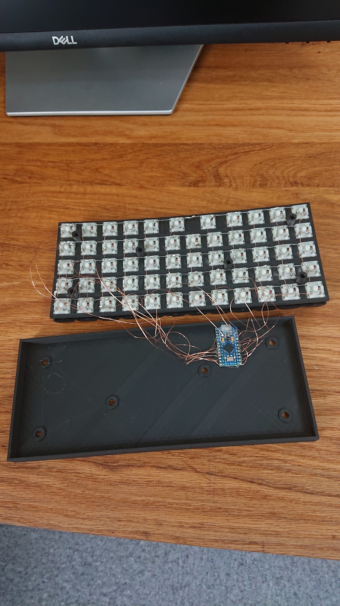
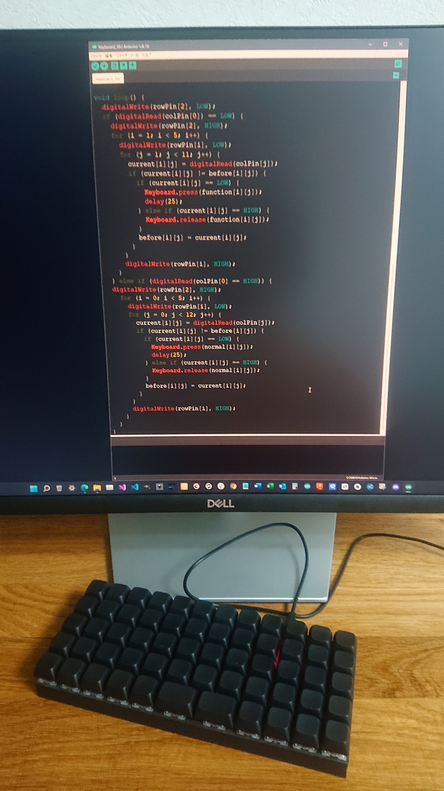
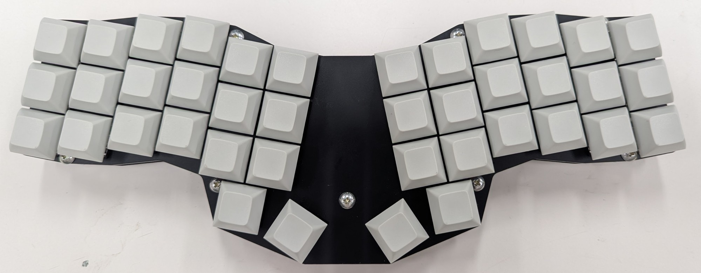
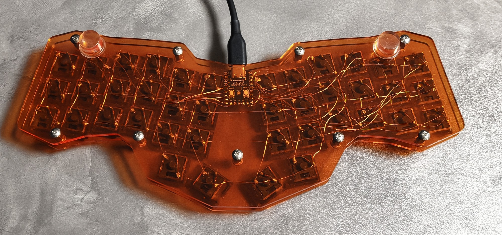

## 初号機(2022)

3D プリンターを導入して最初に作ったもの。59個のキーを、5段12列の碁盤目に並べた。手配線でキーマトリクスを組んでいる。マイコンは Pro Micro で、ポーリング処理はすべて手書きだった。

## 現行機(2025)

キーマップを最適化し、キー数は40個となった。キーのレイアウトも私の腕や手の形にあわせて改良した。レーザーカッターで切り出したアクリル板2枚で、手配線した回路を挟んだシンプルな構造。マイコンは RP2040-Zero に、ファームウェアは QMK に替えた。

キー配列を考えるツールのソースコード: [keymap-lab](https://github.com/morikawa976321/keymap-lab)
