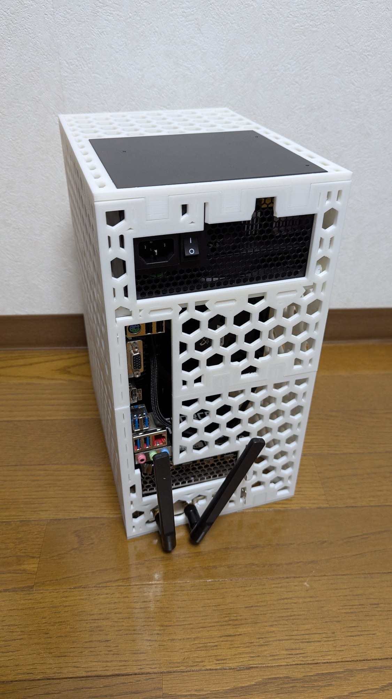
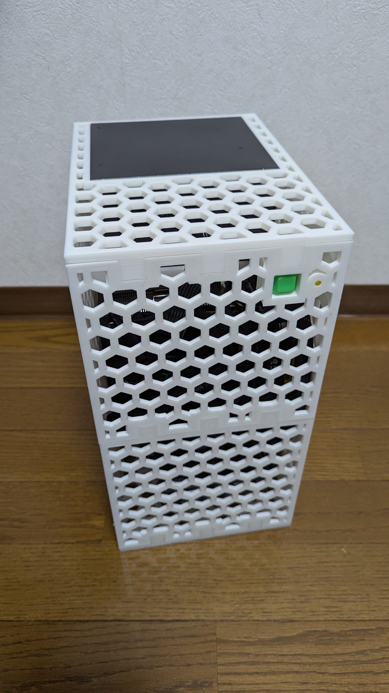
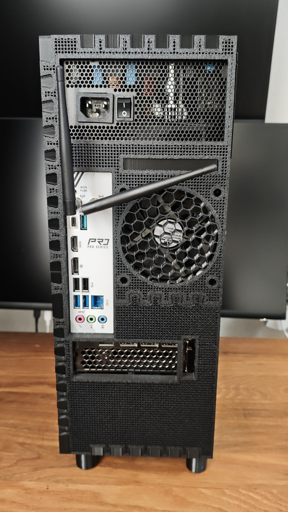
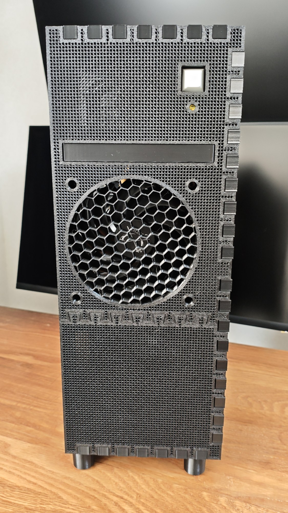
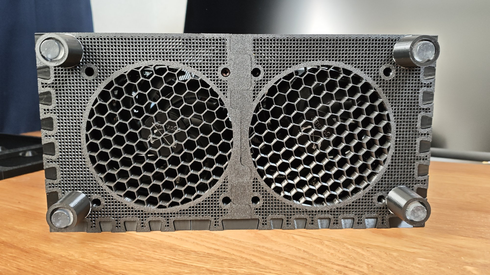
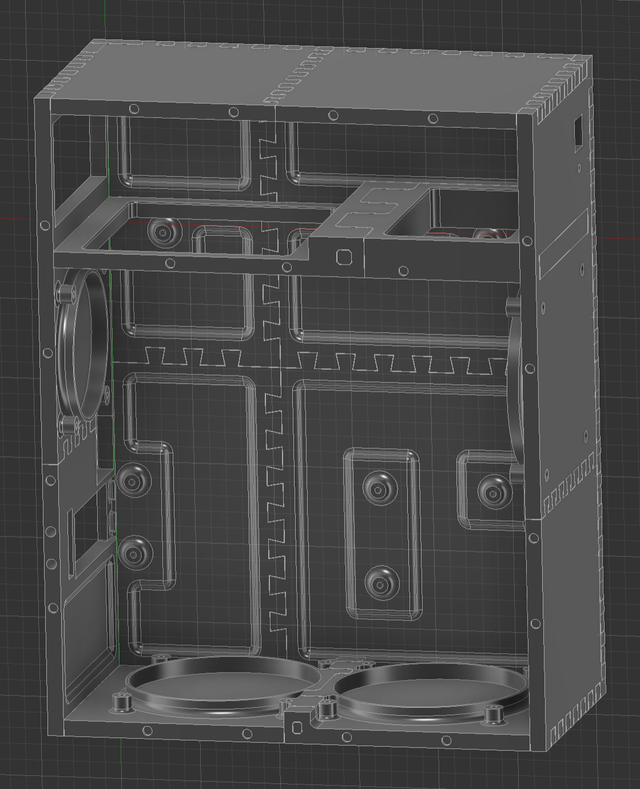
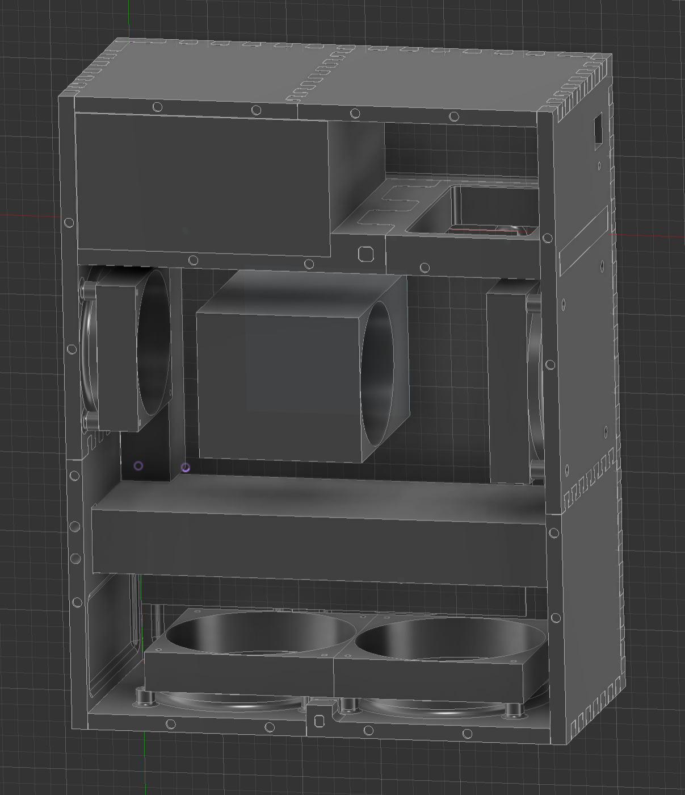

## 1号機

## 2号機(現行)

<video src="/media/matx-pc-case/09-v2-top-panel.mp4" controls preload="metadata" playsinline aria-label="上面のパネルをはめるところの動画"></video>
<video src="/media/matx-pc-case/10-v2-side-panel.mp4" controls preload="metadata" playsinline aria-label="側面のパネルを付けるところの動画"></video>

