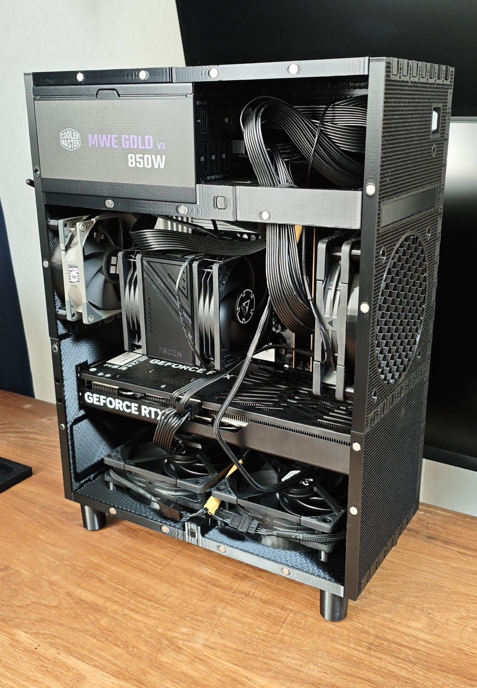
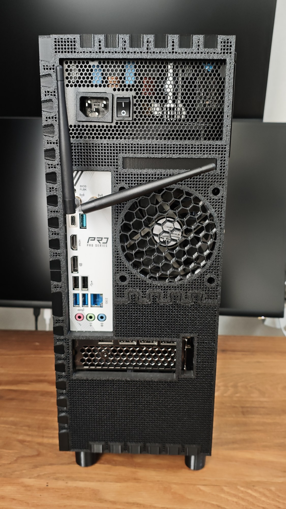
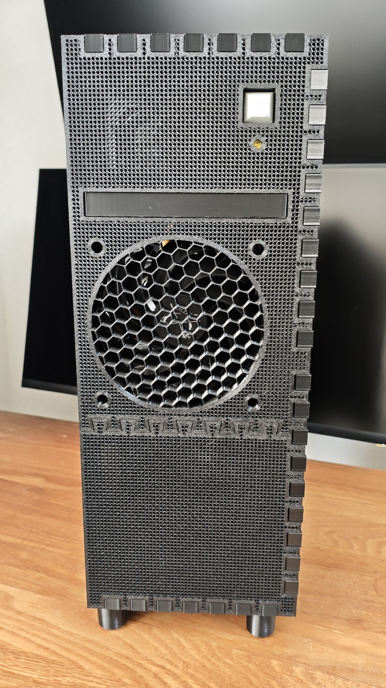
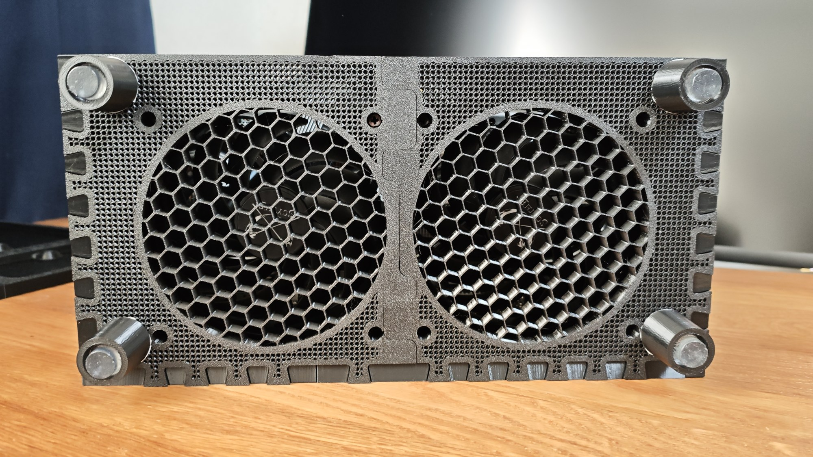
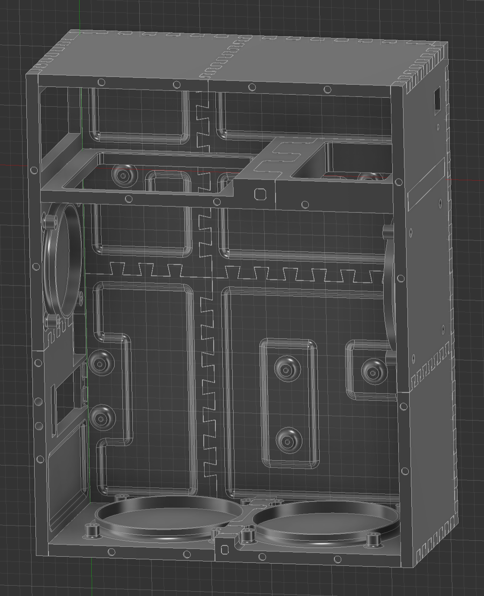
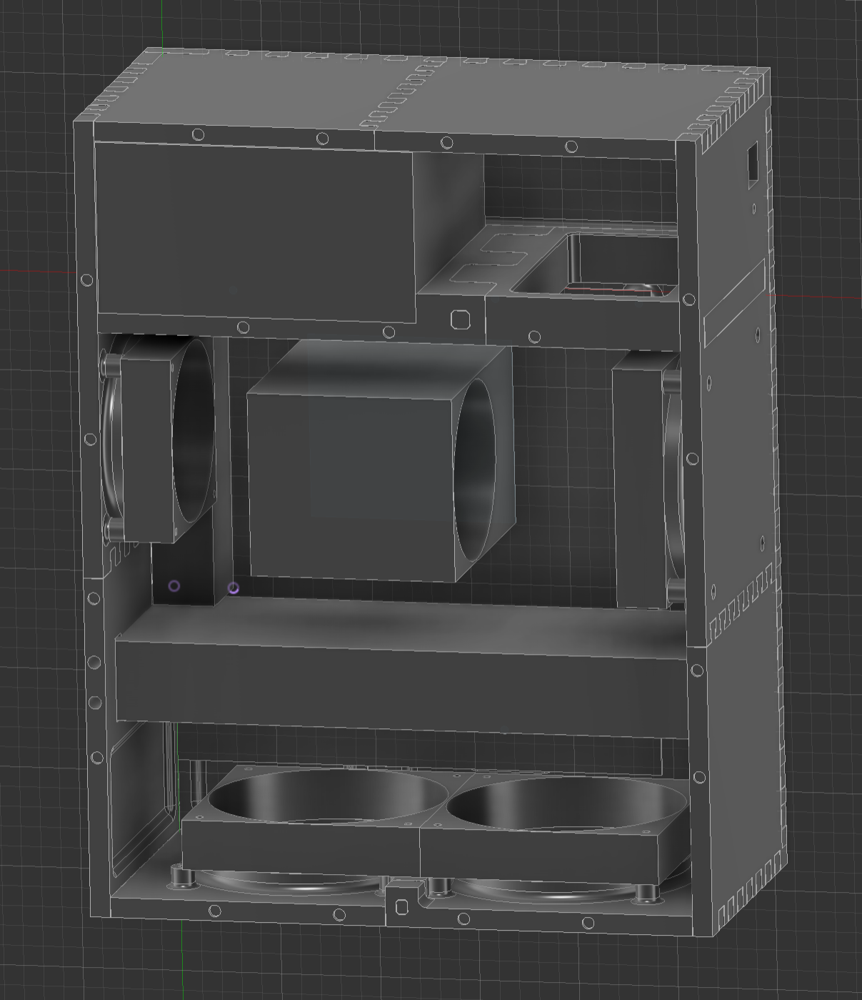

mATX のマザーボード、ATX 電源、グラフィックボードを収める PC ケースを、3D プリンターで作った。中に入る部品に合わせて、体積と設置面積を最小限にしている。ねじも接着剤も使わず、板をはめ込むだけで組み上がる。

Fusion 360 上で最適なパーツ配置を検討しつつ設計した。手元の 3D プリンターで造形できる大きさにするため、各面を2〜4枚に分けている。分けた板どうしは、縁の凸凹をかみ合わせてつなぐ。

板の表面の細かい穴は、造形の内側の充填(インフィル)をそのまま表に出したもので、板全体が通気口になる。ファンの前だけは充填を六角形の粗い格子にして、風を通しやすくした。

<video src="/media/matx-pc-case/09-v2-top-panel.mp4" poster="/media/matx-pc-case/09-v2-top-panel-poster.jpg" controls preload="metadata" playsinline aria-label="上面のパネルをはめるところの動画"></video>
<video src="/media/matx-pc-case/10-v2-side-panel.mp4" poster="/media/matx-pc-case/10-v2-side-panel-poster.jpg" controls preload="metadata" playsinline aria-label="側面のパネルを付けるところの動画"></video>

