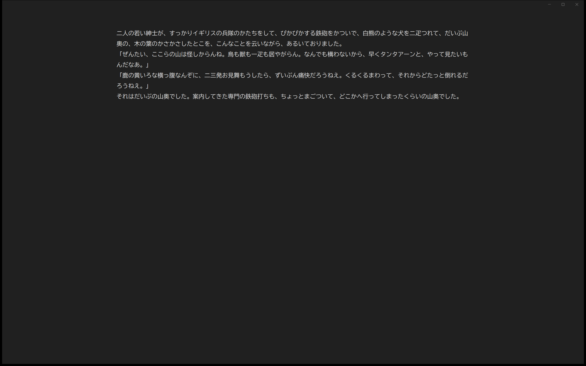
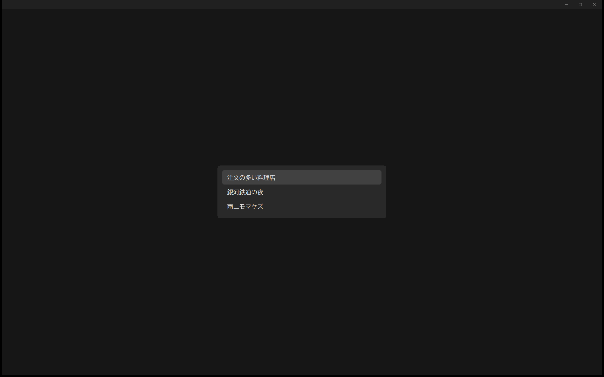

AI の存在を忘れ、一人で文章を書くためのエディター。同じ目的のエディターは既存品にいくらでもあるが、設定画面すら持たせたくなかったので、フォント、配色、保存のしかたをすべて決め打ちにしてある。機能を足すのではなく、書くこと以外に考えることを減らすのが目的である。保存は入力のたびに自動で行い、「保存中」の表示も出さない。

メモの一覧は、Ctrl+P を押したときだけ画面の中央に出る。上下キーと Enter で選ぶと一覧は消え、また本文だけに戻る。すべての操作はキーボードで完結する。最初はブラウザ版を採ったが、メモリを100MBほど使うのが気になり、見た目と操作を保ったまま Rust と Win32 API で作り直した。外部のライブラリは使っておらず、メモリの使用量は約4MBになった。

