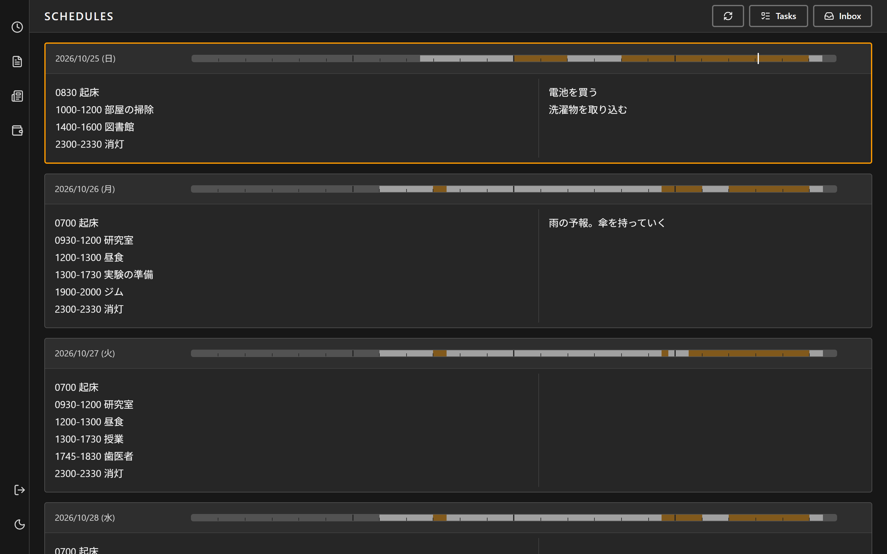
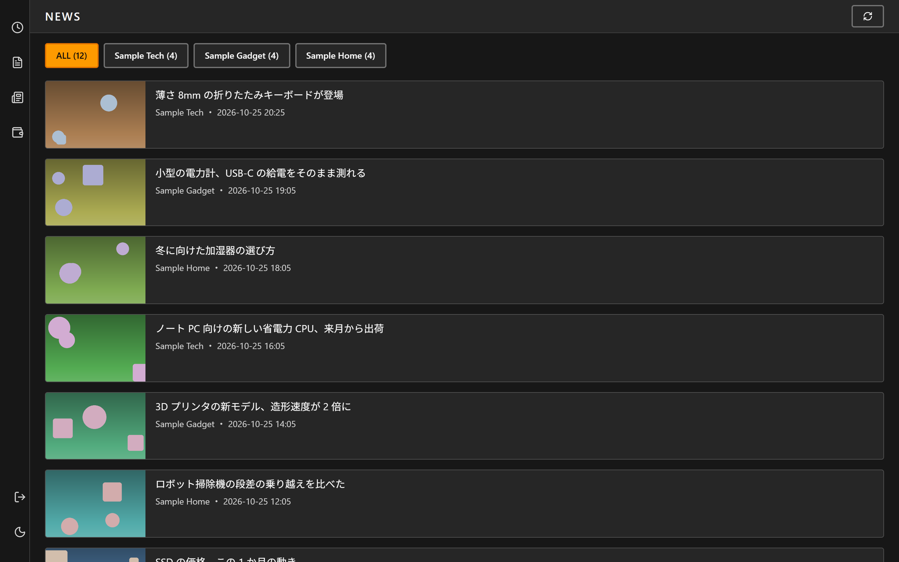
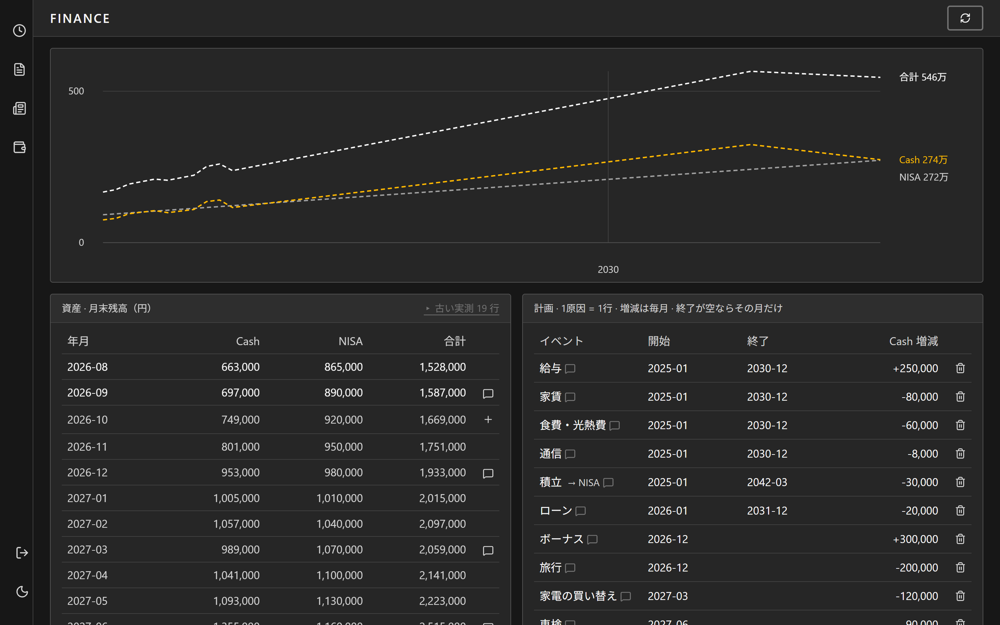

インターン先で関わっている社内の顧客管理ツールが Next.js と Supabase で作られていて、同じ技術で自分も何か作りたいと思ったのが始まりである。作るうちに、予定、思いついたことのメモ、天気、毎日読むニュース、家計の見通しといった、日々変わる自分の情報を一か所に集める道具になった。2026年2月から、毎日使いながら直し続けている。画面の写真は、すべて架空のデータを入れて撮った。

予定は入力欄を埋めるのではなく、「0900-1030 研究」のような1行のテキストで書く。その日のメモは右の欄に書く。空き時間は自分で入力しない。予定だけを正として、そこから睡眠、予定の入っている時間、自由な時間を割り出し、日の見出しに3色の帯で出す。

ニュースは、毎日読んでいたサイトの記事を RSS で1時間ごとに集め、サイトごとに新しい順で並べる。

家計の見通しは、月末の残高の実測と、これからの収入・支出の計画だけを記録する。未来の残高は保存せず、最新の実測に計画を月ごとに足して計算し、折れ線で出す。

機能を足すときの合格基準は、動いたかではなく、使われ続けたかに置いている。作ってみて使わなくなった画面は消してきた。プロジェクトごとの進み具合を並べる板や、目標の期日までに使える時間を累計するグラフがそうである。空き時間の機能も、最も長くまとまった時間の表示などを外し、3色の帯だけを残した。

コードは私ではなくAIが書いている。私は使ってみて、残すものと消すものを決め、画面と操作を指示する。予定は画面から書くだけでなく、AIとの会話からも読み書きできるようにしてあり、AIと相談して組んだ予定をそのまま書き込ませることもできる。
