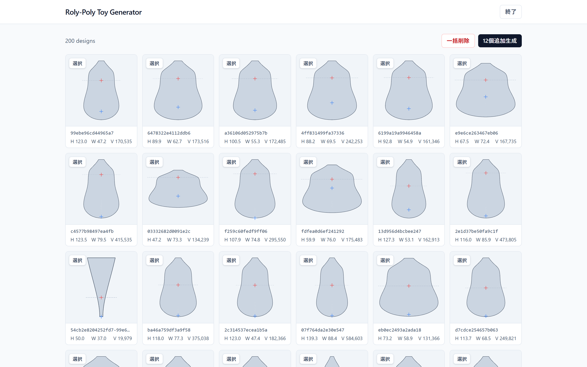
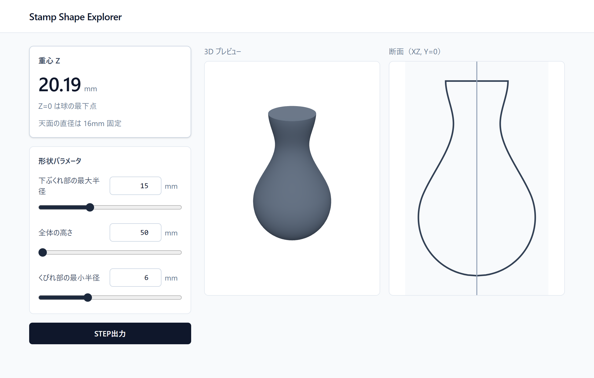
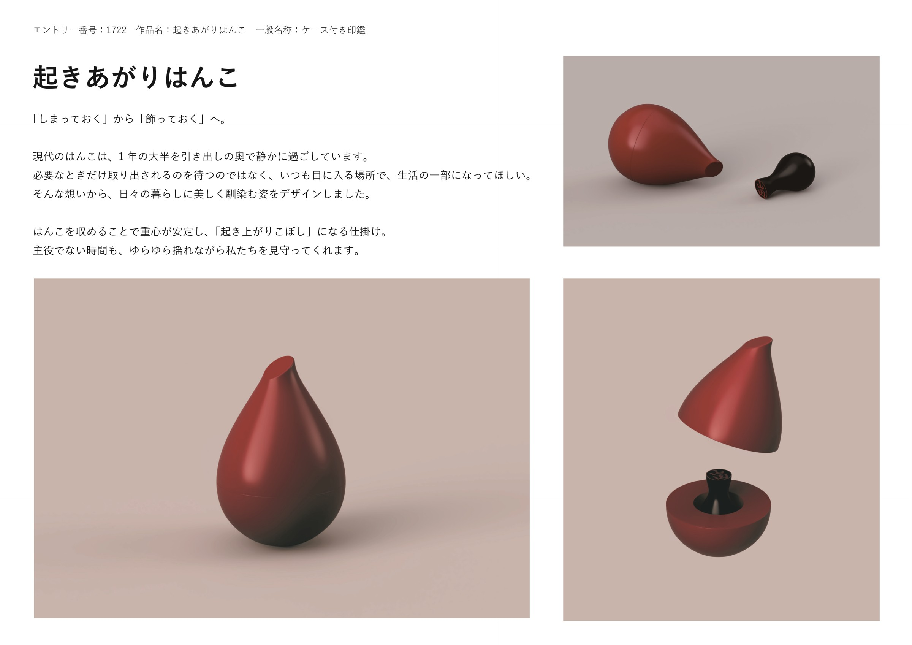

## コンセプト

「しまっておく」から「飾っておく」へ。はんこは1年の大半を引き出しの奥で過ごしている。いつも目に入る場所に置いておけるよう、はんこを収めると重心が安定し、起き上がりこぼしになるケースを作った。

<figure class="slot"><b>01-open.png</b>ケースを上下に分け、中に立っているはんこが見える分解図</figure>

<figure class="slot"><b>02-using.png</b>ケースとはんこを机に置いた、使っている場面の写真</figure>

## 形を決めるための道具

ケースとはんこの形を決めるために、2つのツールを作った。

roly-poly-toy-generator は、起き上がりこぼしの回転体を64個の制御点の半径の並びで表し、遺伝的アルゴリズムで掛け合わせて形を作る。体積と重心を計算し、75° まで傾けても起き上がる形だけを残す。STEP はブラウザの中で書き出す。

stamp-generator は、はんこの縦の断面を、球の半径・くびれの半径・天面の高さの3つで決める。3D 表示と断面図、STEP の書き出し、重心の高さの計算ができる。

## プレゼンシート

SNDC2026 に応募したプレゼンシート。シートは共同制作者が作った。

