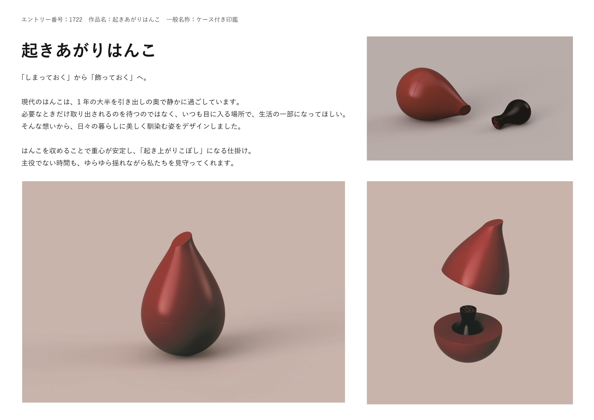
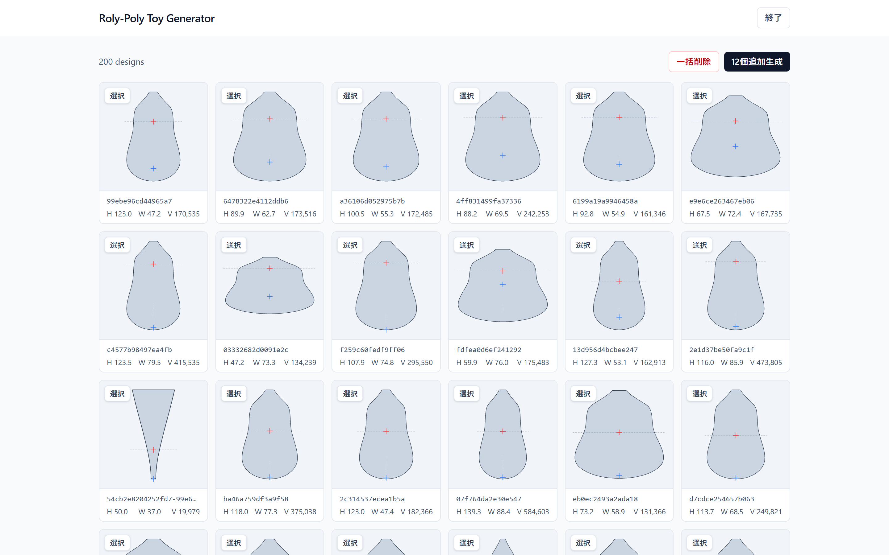
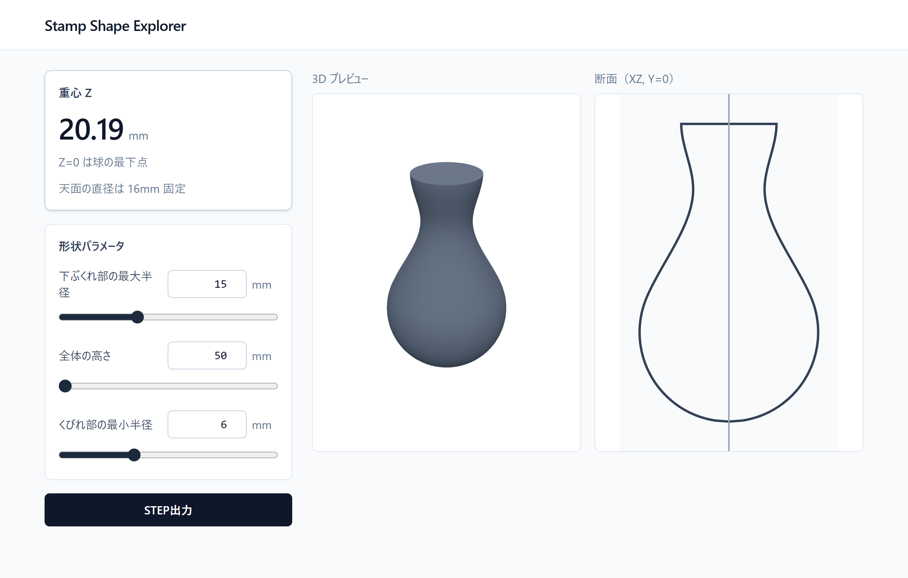

はんこは、1年の大半を引き出しの奥で過ごす。使うのは書類に押すほんの一瞬で、それ以外の時間は誰の目にも触れない。この作品では使わない時間のほうに目を向け、しまっておくのではなく、机や棚に飾っておけるはんこを目指した。

ケースは、はんこを収めると起き上がりこぼしになる。はんこがおもりになって重心が下がるので、倒しても元の姿勢に戻り、使わない間もゆらゆらと揺れている。使うときはケースを上下に分けて、はんこを取り出す。

SHACHIHATA New Product Design Competition 2026 応募作品。

起き上がりこぼしとして成立するかたちをランダムに表示する形状探索ツールを制作した。ランダムに表示される12個の候補から気に入ったものを選ぶと、それらを掛け合わせて次の12個が生成される。

形状の最終調整は別のツールで行った。下ぶくれの最大半径、全体の高さ、くびれの最小半径の3つの寸法を動かすと、3D 表示と断面図がその場で変わる。どちらのツールも、決めた形を STEP で書き出し、そのままモデリングに持ち込める。

ツールのソースコード: [roly-poly-toy-generator](https://github.com/morikawa976321/roly-poly-toy-generator)・[stamp-generator](https://github.com/morikawa976321/stamp-generator)
