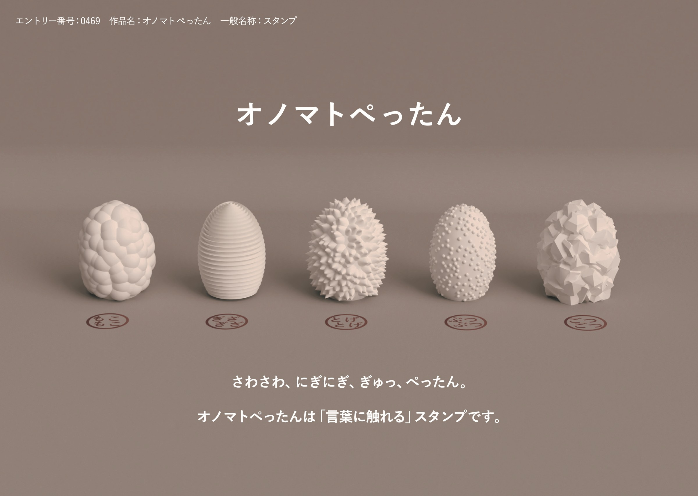
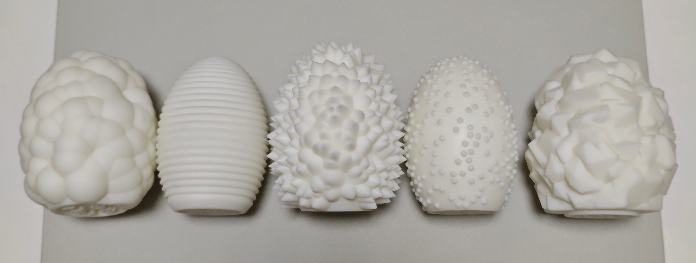

オノマトペをスタンプの持ち手のかたちで表した。5つのスタンプは、もこもこ・ぎざぎざ・とげとげ・ぶつぶつ・ごつごつの手ざわりをしていて、押すとその言葉が紙に残る。かたちを見て、握って手ざわりを確かめ、押して、紙に残った言葉を読む。手で感じたものと目で読む言葉が、一連の動作でつながる。

SHACHIHATA New Product Design Competition 2025 一次審査通過 (67/1681)。

5つの持ち手は同じ卵形をもとにして、表面の凹凸だけを Python で生成した。卵形の表面にランダムに点を取り、そこに部品を足していく。ぶつぶつは小さな球、もこもこは大きな球、とげとげは面に垂直な円錐、ごつごつはランダムな多面体を置いた。ぎざぎざは、縁がぎざぎざの断面を回転させて作った。

一次審査の通過後、展示用の模型を3Dプリントで制作した。

