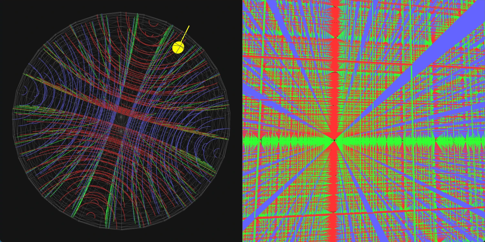

双曲空間を、左右2つの画面で同時に見せる。左は空間全体を1つの球に収めたポアンカレ球を外から眺めた図、右は同じ空間の内側に立つ住人の視界である。右画面では住人の移動と視線操作が行え、その位置と視線方向が左画面の黄色い矢印として表示される。

ソースコード: [poincare-sphere](https://github.com/morikawa976321/poincare-sphere)
