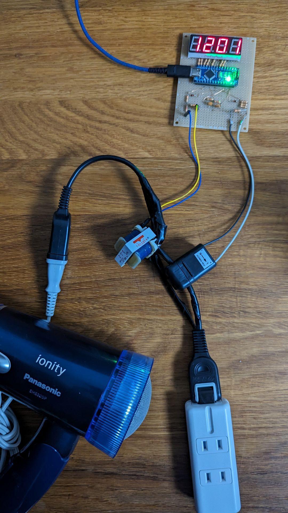
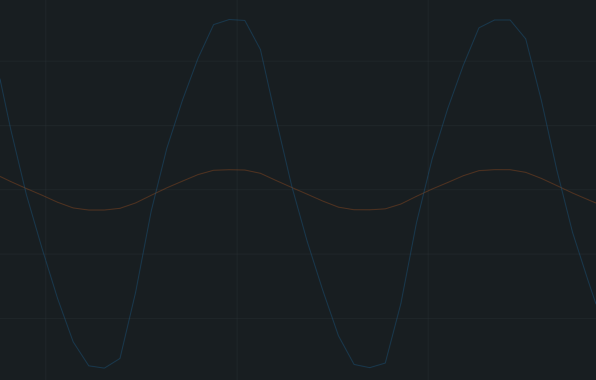
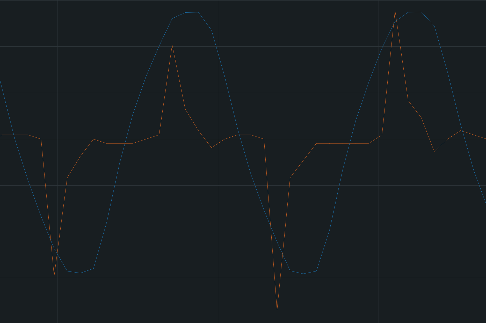

コンセントと電化製品の間に挟み、機器の消費電力をリアルタイムで計測するツール。電流トランスで電流を、電源トランスで電圧を、それぞれ絶縁しつつArduinoのアナログ入力に持ってくる。毎秒2000回程度のサンプリングを行い平均をとることで、1秒ごとの平均消費電力を得る。表示は7セグメントディスプレイ。

PCと接続することで、電圧（青線）と電流（赤線）の波形を観察できる。ほぼ電熱線だけでできているドライヤーは電流波形がきれいな正弦波。

一方でACアダプタは電流波形が複雑な形をしている。位相も少し前にずれている。

