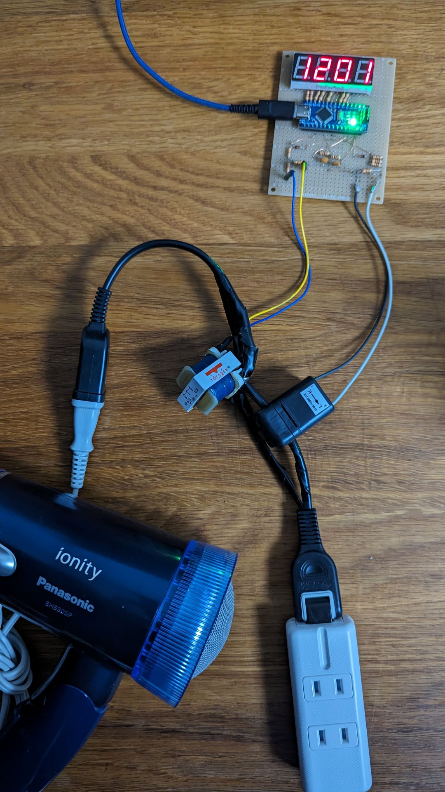
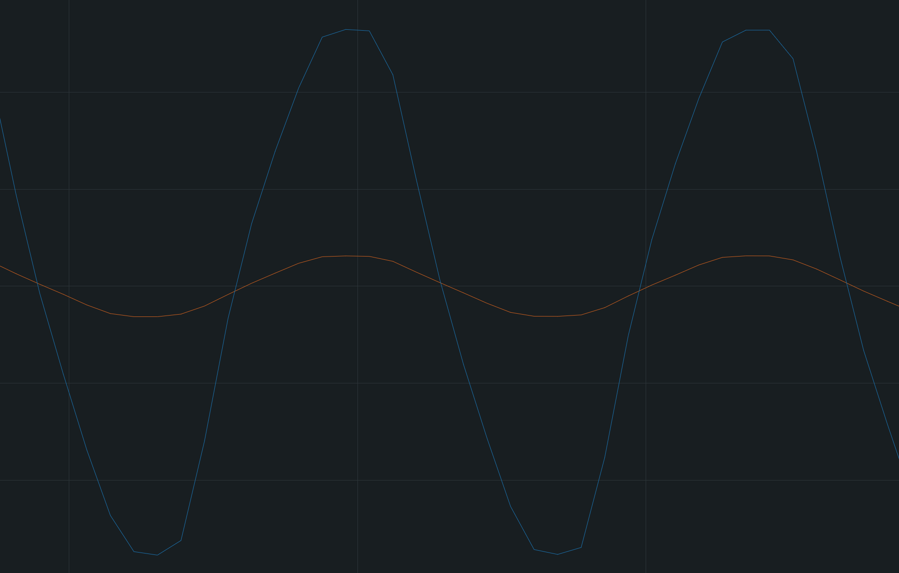
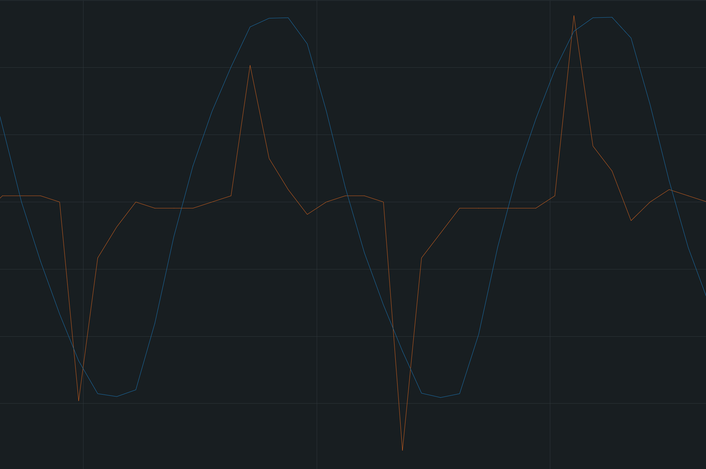

コンセントと家電のあいだに挟んで、家電が使っている電力を測る装置。1秒ごとの平均をワット単位で、4桁の7セグメント表示に出す。

電流は電流トランスで、電圧は電源トランスで取り出し、コンセントの100Vから絶縁したまま Arduino のアナログ入力に入れている。電圧と電流を毎秒2000回ほど読んで、その積を1秒ぶんを平均して消費電力にする。

PC につなぐと、電圧(青)と電流(橙)の波形を見られる。ほぼ電熱線だけでできているドライヤーは、電流もきれいな正弦波になる(右上)。AC アダプターは電流の形が崩れ、山が電圧より少し前にずれる(右下)。掛けてから平均しているので、こうした機器でも実際に使われている電力が出る。
